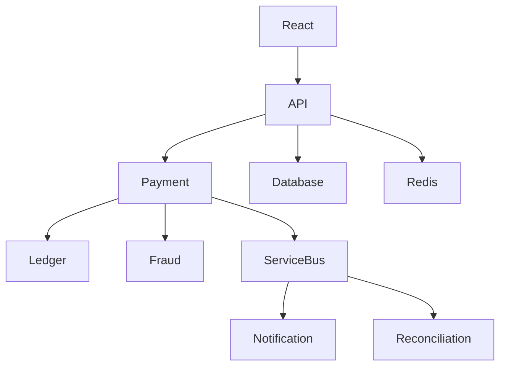

# MASTER PROMPT — Production-Ready FinTech Platform

## 1. ROLE

Act as a **Principal Software Architect + Senior FinTech Engineer + Cloud Architect + DevOps Engineer + Security Engineer**.

I want you to design and implement a **production-grade FinTech platform** that demonstrates genuine end-to-end understanding of modern financial technology systems.

This is NOT a simple CRUD application.

The project should demonstrate understanding of:

- Financial accounts
- Customers
- KYC
- Payments
- Transactions
- Double-entry ledger
- Wallets
- Money movement
- Payment lifecycle
- Fraud detection
- Risk scoring
- Transaction limits
- Idempotency
- Reconciliation
- Settlement
- Notifications
- Event-driven architecture
- Distributed systems
- Audit trails
- Compliance concepts
- Authentication/authorization
- Observability
- Caching
- Messaging
- Retry mechanisms
- Dead-letter queues
- Eventual consistency
- Database transactions
- Concurrency
- Distributed locks
- API security
- Data protection
- Reporting
- Operational monitoring
- CI/CD
- Disaster recovery
- Scalability

The implementation must make it obvious that the developer understands the **bigger picture of FinTech architecture**, rather than simply knowing Python, .NET, React, or Azure individually.

---

# 2. CORE REQUIREMENT

Create TWO completely separate backend implementations of the same FinTech platform.

## Backend A — Python

Technology:

- Python 3.12+
- FastAPI
- Pydantic
- SQLAlchemy 2.x
- Alembic
- PostgreSQL
- Redis
- Azure Service Bus emulator/local equivalent
- Azure Storage emulator/local equivalent
- Pytest
- httpx
- structlog
- OpenTelemetry
- Docker
- Docker Compose

## Backend B — .NET

Technology:

- .NET 8/9+
- ASP.NET Core Web API
- C#
- Entity Framework Core
- PostgreSQL or SQL Server
- Redis
- Azure Service Bus emulator/local equivalent
- Azure Storage emulator/local equivalent
- xUnit
- Moq/NSubstitute
- FluentAssertions
- Serilog
- OpenTelemetry
- Docker
- Docker Compose

## Frontend

Use one common frontend:

- React
- TypeScript
- Vite
- React Router
- TanStack Query
- Axios/fetch
- React Hook Form
- Zod
- Material UI or another professional component library
- Recharts for financial dashboards

The React frontend should be capable of switching between the Python and .NET APIs using configuration.

Example:

```env
VITE_API_URL=http://localhost:8000
```

or

```env
VITE_API_URL=http://localhost:5000
```

The frontend must NOT contain business logic that belongs to the backend.

---

# 3. PROJECT NAME

Use a professional name:

# FinCore — Enterprise FinTech Transaction & Payment Platform

The system represents a simplified but realistic financial technology platform.

The platform allows customers to:

- Register
- Complete KYC
- Create accounts/wallets
- Add beneficiaries
- Transfer money
- View transactions
- View balances
- Receive notifications
- View statements
- Monitor payment status

The platform also provides operational capabilities for:

- Fraud analysts
- Finance teams
- Operations teams
- Compliance teams
- Administrators

---

# 4. IMPORTANT ARCHITECTURAL PRINCIPLE

Do NOT create one giant monolithic CRUD API.

Start with a **modular monolith / service-oriented architecture** that can later evolve into microservices.

Clearly separate:

```text
Presentation
    ↓
Application
    ↓
Domain
    ↓
Infrastructure
```

Use Domain-Driven Design concepts where appropriate.

Organize the system around business capabilities rather than technical folders.

Example:

```text
Customer
Account
Payment
Transaction
Ledger
Fraud
KYC
Reconciliation
Notification
Reporting
Audit
```

---

# 5. HIGH-LEVEL ARCHITECTURE

Design the architecture approximately as:

```text
                    ┌──────────────────────┐
                    │      React App       │
                    │      TypeScript      │
                    └──────────┬───────────┘
                               │
                               ▼
                    ┌──────────────────────┐
                    │       API Layer      │
                    │ Authentication       │
                    │ Authorization        │
                    │ Rate Limiting        │
                    └──────────┬───────────┘
                               │
             ┌─────────────────┼──────────────────┐
             │                 │                  │
             ▼                 ▼                  ▼
       Customer Module    Payment Module     Account Module
             │                 │                  │
             └─────────────────┼──────────────────┘
                               │
                               ▼
                       Transaction Engine
                               │
                               ▼
                         Ledger Engine
                               │
                               ▼
                    ┌─────────────────────┐
                    │ Event Bus / Queue   │
                    │ Azure Service Bus    │
                    └──────────┬──────────┘
                               │
            ┌──────────────────┼─────────────────┐
            ▼                  ▼                 ▼
       Fraud Service      Notification      Reconciliation
                           Service             Service
            │                  │                 │
            ▼                  ▼                 ▼
          Redis             Email/SMS          Reports
                              
                              
       ┌─────────────────────────────────────────────┐
       │                    Data                     │
       │ PostgreSQL / SQL Server                     │
       │ Redis                                       │
       │ Azure Blob Storage                          │
       └─────────────────────────────────────────────┘
```

Explain every component and why it exists.

---

# 6. FINTECH BUSINESS DOMAIN

Implement the following domains.

## Customer Management

Entities:

```text
Customer
CustomerProfile
Address
ContactInformation
```

Capabilities:

- Registration
- Login
- Profile management
- Account status
- Customer lifecycle

Customer states:

```text
Pending
Active
Suspended
Blocked
Closed
```

---

# 7. KYC MODULE

Implement simplified KYC.

Entities:

```text
KycApplication
KycDocument
KycVerification
```

Workflow:

```text
Customer Registration
        ↓
KYC Application
        ↓
Document Upload
        ↓
Verification
        ↓
Approved / Rejected / Manual Review
```

Statuses:

```text
Pending
UnderReview
Approved
Rejected
Expired
```

Use Azure Blob Storage emulator for documents.

Never store actual sensitive documents directly in the database.

Store:

```text
DocumentId
CustomerId
BlobPath
DocumentType
UploadedAt
VerificationStatus
```

---

# 8. ACCOUNT MODULE

Implement:

```text
CustomerAccount
Wallet
AccountBalance
AccountLimit
```

Account types:

```text
Checking
Savings
Wallet
Merchant
```

Statuses:

```text
Active
Frozen
Closed
Suspended
```

Support:

- Available balance
- Ledger balance
- Daily transaction limit
- Monthly transaction limit
- Currency
- Account status

Never represent money using floating point.

Use:

```text
Decimal
```

or integer minor units.

Prefer:

```text
amount_minor = 10050
currency = INR
```

meaning:

```text
₹100.50
```

Explain why floating point is dangerous for financial systems.

---

# 9. DOUBLE-ENTRY LEDGER

This is one of the most important parts of the system.

Implement a proper double-entry accounting ledger.

Entities:

```text
LedgerAccount
JournalEntry
JournalLine
```

Every financial transaction must follow:

```text
Total Debit = Total Credit
```

Example:

Customer A sends ₹500 to Customer B.

Ledger:

```text
Customer A Account
Debit   ₹500

Customer B Account
Credit  ₹500
```

Do NOT simply update:

```text
balance = balance - amount
```

without recording ledger entries.

Implement immutable ledger entries.

Ledger entries must NEVER be modified or deleted.

If a correction is required:

```text
Original Entry
       ↓
Reversal Entry
       ↓
Correct Entry
```

Explain this clearly in the architecture documentation.

---

# 10. PAYMENT MODULE

Implement payment lifecycle:

```text
Initiated
    ↓
Pending
    ↓
Processing
    ↓
Completed
```

Failure states:

```text
Failed
Cancelled
Rejected
Expired
```

Payment flow:

```text
POST /payments

      ↓

Validate Request

      ↓

Validate Customer

      ↓

Validate Account

      ↓

Validate Balance

      ↓

Validate Limits

      ↓

Fraud Check

      ↓

Create Payment

      ↓

Create Transaction

      ↓

Create Ledger Entries

      ↓

Publish PaymentCompleted Event

      ↓

Notification

      ↓

Reconciliation
```

---

# 11. IDEMPOTENCY

This MUST be implemented.

Financial APIs must not accidentally process the same payment twice.

Example:

```http
POST /api/payments
Idempotency-Key: 7d9d0d1e-1234
```

If the client retries the same request:

```text
Same Idempotency-Key
+
Same Request
=
Return Original Result
```

Do not create another payment.

Store:

```text
IdempotencyKey
RequestHash
Response
Status
CreatedAt
```

Explain why this is critical in payment systems.

---

# 12. TRANSACTION STATE MACHINE

Implement payment state transitions.

Example:

```text
Initiated
    ↓
Pending
    ↓
Processing
    ↓
Completed
```

Invalid transitions must be rejected.

Example:

```text
Completed → Processing
```

must fail.

Create a proper state machine rather than scattered `if` statements.

---

# 13. BENEFICIARY MODULE

Implement:

```text
Beneficiary
BeneficiaryVerification
```

Capabilities:

- Add beneficiary
- Verify beneficiary
- Activate beneficiary
- Disable beneficiary

Add optional cooling period:

```text
New Beneficiary
       ↓
Cooling Period
       ↓
Active
```

Explain why financial institutions use controls like this.

---

# 14. FRAUD DETECTION

Create a rule-based fraud engine.

Example rules:

```text
Rule 1:
Transaction amount > configured threshold

Rule 2:
Multiple transactions within short period

Rule 3:
Unusual location

Rule 4:
Too many failed transactions

Rule 5:
Transaction velocity exceeds limit

Rule 6:
New beneficiary + high amount

Rule 7:
Account recently created + large transfer
```

Calculate:

```text
FraudScore
RiskLevel
```

Example:

```text
0-30     Low
31-60    Medium
61-80    High
81-100   Critical
```

Actions:

```text
Allow
Review
Block
```

Create a configurable rules engine rather than hard-coding everything.

---

# 15. RISK ENGINE

Create a separate risk evaluation concept.

Input:

```text
Customer
Account
Transaction
Device
Location
History
```

Output:

```text
RiskScore
RiskLevel
Reasons
Decision
```

Example:

```json
{
  "riskScore": 82,
  "riskLevel": "Critical",
  "decision": "Block",
  "reasons": [
    "High transaction velocity",
    "Large amount",
    "New beneficiary"
  ]
}
```

---

# 16. TRANSACTION LIMITS

Support configurable limits:

```text
Per Transaction
Daily
Weekly
Monthly
```

Example:

```text
Maximum transaction = ₹100,000
Daily limit = ₹500,000
Monthly limit = ₹2,000,000
```

The limits must be configurable.

Do not hard-code business rules.

---

# 17. EVENT-DRIVEN ARCHITECTURE

Use an event bus.

Events:

```text
CustomerCreated
KycSubmitted
KycApproved
AccountCreated
PaymentInitiated
PaymentProcessed
PaymentCompleted
PaymentFailed
FraudDetected
TransactionCreated
LedgerPosted
NotificationRequested
ReconciliationRequired
```

Example:

```text
PaymentCompleted
        ↓
Service Bus
        ↓
 ┌──────┼─────────┐
 ▼      ▼         ▼
Notify  Audit   Reconcile
```

Use Azure Service Bus emulator/local equivalent.

Explain:

- Queue
- Topic
- Subscription
- Message
- Retry
- Dead Letter Queue
- Duplicate detection
- Message ordering
- At-least-once delivery

---

# 18. OUTBOX PATTERN

Implement the Outbox Pattern.

Problem:

```text
Database Commit
       +
Message Publishing
```

can fail independently.

Example:

```text
DB transaction succeeds
Service Bus publish fails
```

Without an outbox, the event is lost.

Implement:

```text
Business Transaction
        ↓
Database Transaction
        ↓
Business Data
+
Outbox Event
        ↓
Commit
        ↓
Background Worker
        ↓
Publish Event
        ↓
Mark Outbox Event Processed
```

This is mandatory.

---

# 19. RETRY + DEAD LETTER

Implement retry policies.

Example:

```text
Attempt 1
   ↓
Attempt 2
   ↓
Attempt 3
   ↓
Dead Letter Queue
```

Use exponential backoff.

Explain why infinite retry is dangerous.

Implement:

```text
max retries
backoff
dead letter
manual replay
```

---

# 20. RECONCILIATION

Create a reconciliation module.

This is an important real-world FinTech concept.

The reconciliation system compares:

```text
Internal Transactions
        VS
External Payment Provider Transactions
```

Example:

```text
Internal:
TX1001 ₹500 Completed

External:
TX1001 ₹500 Completed

=> MATCH
```

Mismatch:

```text
Internal:
TX1002 ₹1,000 Completed

External:
TX1002 ₹1,000 Failed

=> MISMATCH
```

Statuses:

```text
Matched
Unmatched
AmountMismatch
StatusMismatch
MissingInternal
MissingExternal
```

Create reconciliation reports.

---

# 21. EXTERNAL PAYMENT PROVIDER SIMULATOR

Do not integrate a real payment provider initially.

Create:

```text
PaymentProviderSimulator
```

It should simulate:

```text
Success
Failure
Timeout
Duplicate Response
Delayed Response
Partial Failure
```

This allows testing distributed systems behavior.

---

# 22. NOTIFICATION SERVICE

Create notification capability.

Types:

```text
Email
SMS
Push
InApp
```

For local development use mock providers.

Events:

```text
PaymentCompleted
PaymentFailed
FraudDetected
KycApproved
AccountBlocked
```

Store notification history.

---

# 23. AUDIT SYSTEM

Every important operation must generate an audit event.

Examples:

```text
Login
CustomerUpdated
KycApproved
PaymentCreated
PaymentCompleted
PaymentFailed
AccountFrozen
BeneficiaryCreated
FraudRuleTriggered
AdminAction
```

Store:

```text
Actor
Action
Entity
EntityId
Timestamp
IPAddress
CorrelationId
OldValue
NewValue
```

Audit logs must be append-only.

---

# 24. AUTHENTICATION

Implement:

```text
JWT Authentication
Refresh Tokens
Password Hashing
Role-Based Authorization
```

Roles:

```text
Customer
Admin
Operations
FraudAnalyst
ComplianceOfficer
FinanceUser
```

Use secure password hashing.

Never store plaintext passwords.

---

# 25. AUTHORIZATION

Examples:

Customer:

```text
View own account
View own transactions
Create payments
```

Fraud Analyst:

```text
View suspicious transactions
Review fraud cases
```

Finance:

```text
View reconciliation
View settlement
```

Admin:

```text
Manage configuration
Manage users
```

Implement proper authorization policies.

---

# 26. API DESIGN

Create REST APIs.

Examples:

```http
POST   /api/auth/register
POST   /api/auth/login

GET    /api/customers/{id}

POST   /api/kyc
GET    /api/kyc/{id}

POST   /api/accounts
GET    /api/accounts/{id}

POST   /api/beneficiaries
GET    /api/beneficiaries

POST   /api/payments
GET    /api/payments/{id}

GET    /api/transactions
GET    /api/transactions/{id}

GET    /api/ledger/accounts/{id}

GET    /api/fraud/cases
POST   /api/fraud/cases/{id}/review

GET    /api/reconciliation
POST   /api/reconciliation/run

GET    /api/reports/transactions
GET    /api/reports/payments
```

Use:

- Pagination
- Filtering
- Sorting
- Validation
- Consistent response format
- Error handling
- Correlation IDs

---

# 27. API ERROR FORMAT

Use a standard structure.

Example:

```json
{
  "type": "https://api.example.com/errors/insufficient-funds",
  "title": "Insufficient Funds",
  "status": 400,
  "detail": "The account does not have sufficient available balance.",
  "traceId": "abc-123"
}
```

Use RFC 7807 / ProblemDetails where appropriate.

---

# 28. CORRELATION ID

Every request should have:

```text
CorrelationId
TraceId
```

Example:

```text
HTTP Request
     ↓
API
     ↓
Payment Service
     ↓
Service Bus
     ↓
Fraud Service
     ↓
Notification Service
```

The same correlation information should allow tracing the entire transaction.

---

# 29. OBSERVABILITY

Implement:

## Logging

Python:

```text
structlog
```

.NET:

```text
Serilog
```

Log:

```text
CorrelationId
TraceId
CustomerId
TransactionId
PaymentId
EventId
```

Never log:

```text
Password
CVV
Full card number
Authentication secrets
Sensitive KYC documents
```

---

# 30. DISTRIBUTED TRACING

Use OpenTelemetry.

Trace:

```text
React
 ↓
API
 ↓
Database
 ↓
Service Bus
 ↓
Worker
 ↓
External Provider
```

Create spans for important financial operations.

---

# 31. METRICS

Expose metrics such as:

```text
payments_total
payments_success_total
payments_failed_total
payment_processing_duration
fraud_detected_total
reconciliation_mismatch_total
service_bus_messages_processed
service_bus_messages_failed
api_request_duration
```

---

# 32. CACHING

Use Redis.

Potential cache:

```text
Customer profile
Account configuration
Transaction limits
Fraud rules
Reference data
```

Do NOT blindly cache financial balances.

Explain cache invalidation.

Implement:

```text
Cache Aside Pattern
```

---

# 33. DATABASE DESIGN

Use relational database.

Design tables for:

```text
Customers
CustomerProfiles
KycApplications
KycDocuments
Accounts
AccountLimits
Beneficiaries
Payments
Transactions
LedgerAccounts
JournalEntries
JournalLines
FraudCases
FraudRules
RiskAssessments
Notifications
AuditLogs
OutboxMessages
ReconciliationRecords
IdempotencyRecords
RefreshTokens
```

Use:

- Primary keys
- Foreign keys
- Unique constraints
- Indexes
- Check constraints
- Optimistic concurrency where appropriate

Provide ER diagram.

---

# 34. DATABASE TRANSACTIONS

Financial operations must use database transactions.

Example:

```text
Begin Transaction

Create Payment

Create Transaction

Create Journal Entry

Create Journal Lines

Create Outbox Event

Commit

```

If anything fails:

```text
Rollback
```

Never allow:

```text
Payment Created
BUT
Ledger Not Updated
```

---

# 35. CONCURRENCY

Handle two simultaneous withdrawals/transfers.

Example:

```text
Balance = ₹1,000

Request A → Withdraw ₹800
Request B → Withdraw ₹800
```

The system must NOT allow both.

Implement appropriate concurrency control.

Discuss:

- Optimistic concurrency
- Pessimistic locking
- Database isolation levels
- Row versioning
- Race conditions

Provide tests proving the system prevents double spending.

---

# 36. SECURITY

Implement:

```text
OWASP API Security
JWT
RBAC
Input Validation
Rate Limiting
CORS
HTTPS
Secure Headers
Password Hashing
Secret Management
SQL Injection Protection
Audit Logging
```

Use environment variables for secrets.

Never commit:

```text
Passwords
JWT secrets
Connection strings
API keys
Certificates
```

---

# 37. RATE LIMITING

Implement API rate limiting.

Examples:

```text
Login:
5 requests/minute

Payment:
10 requests/minute

General API:
100 requests/minute
```

Make limits configurable.

---

# 38. FINANCIAL DATA SECURITY

Clearly identify sensitive information.

Classify data:

```text
Public
Internal
Confidential
Highly Confidential
```

Explain:

- Encryption at rest
- Encryption in transit
- Key management
- Data masking
- Tokenization
- PII protection

Do not store real card data.

Use mock/tokenized payment information.

---

# 39. PCI DSS AWARENESS

The application should demonstrate awareness of PCI DSS without claiming to be PCI compliant.

Explain:

```text
Do not store CVV
Do not store raw PAN
Use tokenization
Minimize cardholder data
Restrict access
Audit access
Encrypt sensitive data
```

Clearly label the project:

> Educational production-style architecture, not a certified financial production system.

---

# 40. COMPLIANCE AWARENESS

Include conceptual support for:

```text
KYC
AML
Transaction monitoring
Sanctions screening
Audit trails
Data retention
Suspicious activity
```

Create a mock sanctions screening service.

Example:

```text
Customer Name
      ↓
Sanctions Screening
      ↓
Clear / Potential Match
```

Do NOT connect to real sanctions data initially.

---

# 41. AML TRANSACTION MONITORING

Create basic AML rules.

Examples:

```text
Structuring / Smurfing
Rapid movement of funds
High transaction velocity
Unusual transaction amount
Multiple beneficiaries
```

Generate:

```text
AML Alert
```

Statuses:

```text
Open
Investigating
Escalated
Closed
FalsePositive
```

---

# 42. REPORTING

Create dashboards.

Customer dashboard:

```text
Balance
Recent Transactions
Monthly Spending
Payments
```

Operations dashboard:

```text
Total Payments
Success Rate
Failure Rate
Pending Payments
```

Fraud dashboard:

```text
Fraud Cases
Risk Distribution
Blocked Transactions
Top Rules
```

Finance dashboard:

```text
Settlement
Reconciliation
Mismatches
Transaction Volume
```

---

# 43. REACT FRONTEND

Create professional UI.

Pages:

```text
Login
Register
Dashboard
Accounts
Account Details
Payments
Create Payment
Transactions
Transaction Details
Beneficiaries
KYC
Notifications
Fraud Cases
Reconciliation
Reports
Admin
```

Use responsive design.

---

# 44. REACT ARCHITECTURE

Use:

```text
src/
 ├── api/
 ├── components/
 ├── features/
 │    ├── auth/
 │    ├── accounts/
 │    ├── payments/
 │    ├── transactions/
 │    ├── fraud/
 │    ├── kyc/
 │    └── reconciliation/
 ├── hooks/
 ├── layouts/
 ├── pages/
 ├── routes/
 ├── types/
 ├── utils/
 └── App.tsx
```

Use feature-based organization.

---

# 45. DOCKER

Create Dockerfiles for:

```text
Python API
.NET API
React
PostgreSQL
Redis
Workers
```

Create:

```text
docker-compose.yml
```

that can run the entire platform locally.

---

# 46. LOCAL AZURE EMULATION

The project must be designed to use locally available Azure emulators.

Create an abstraction around Azure services.

Examples:

```text
AzureServiceBus
AzureBlobStorage
AzureQueue
AzureStorage
```

The application should be able to switch between:

```text
LOCAL
```

and

```text
AZURE
```

through configuration.

Example:

```env
ENVIRONMENT=Local
STORAGE_PROVIDER=Azurite
MESSAGE_PROVIDER=AzureServiceBus
```

Avoid tightly coupling business logic directly to Azure SDK calls.

Use interfaces.

Python:

```python
class EventBus(Protocol):
    async def publish(self, event):
        ...
```

.NET:

```csharp
public interface IEventBus
{
    Task PublishAsync<T>(T message);
}
```

Implement:

```text
LocalEventBus
AzureEventBus
```

where appropriate.

---

# 47. AZURE SERVICES TO MODEL

Design the application so that production deployment could use:

```text
Azure App Service / AKS
Azure API Management
Azure Service Bus
Azure SQL
Azure Database for PostgreSQL
Azure Cache for Redis
Azure Blob Storage
Azure Key Vault
Azure Application Insights
Azure Monitor
Azure Container Registry
Azure Functions
Azure Event Grid
Azure Front Door
Azure WAF
```

Do not force every service into the application.

For each service explain:

```text
Why it exists
When to use it
What problem it solves
Alternative
Cost consideration
Failure scenario
```

---

# 48. API MANAGEMENT

Show where Azure API Management would sit:

```text
React
 ↓
Azure Front Door
 ↓
WAF
 ↓
API Management
 ↓
Backend
```

Explain:

- Authentication
- Rate limiting
- API versioning
- Policies
- Subscription keys
- Routing
- Observability

---

# 49. BACKGROUND WORKERS

Implement background processing for:

```text
Outbox processing
Payment processing
Notifications
Reconciliation
Fraud monitoring
Report generation
```

Python:

```text
Celery / asyncio worker / dedicated worker
```

Prefer a simple dedicated worker architecture unless another technology is necessary.

.NET:

```text
BackgroundService
```

---

# 50. CI/CD

Create GitHub Actions pipelines.

Pipeline:

```text
Developer
   ↓
Git Push
   ↓
Pull Request
   ↓
Lint
   ↓
Unit Tests
   ↓
Integration Tests
   ↓
Security Scan
   ↓
Build Docker Image
   ↓
Push Image
   ↓
Deploy
   ↓
Smoke Tests
   ↓
Production
```

Create separate workflows for:

```text
Python
.NET
React
Docker
```

---

# 51. TESTING STRATEGY

Implement:

## Unit Tests

Test:

```text
Payment rules
Fraud rules
Risk engine
Ledger calculations
Transaction limits
State transitions
```

## Integration Tests

Test:

```text
API + Database
API + Redis
API + Service Bus
Outbox
```

## Contract Tests

Ensure:

```text
Python API
=
.NET API
```

from the perspective of the React frontend.

The same endpoint must return compatible contracts.

## End-to-End Tests

Example:

```text
Register Customer
 ↓
Login
 ↓
Create Account
 ↓
Add Beneficiary
 ↓
Create Payment
 ↓
Fraud Check
 ↓
Ledger Entry
 ↓
Notification
 ↓
View Transaction
```

---

# 52. FAILURE TESTING

Explicitly test:

```text
Database unavailable
Redis unavailable
Service Bus unavailable
Payment provider timeout
Duplicate message
Duplicate API request
Worker crash
Network timeout
Partial failure
```

Show how the system recovers.

---

# 53. CHAOS / RESILIENCE SCENARIOS

Create simple local simulations.

Examples:

```text
Kill payment worker
Restart worker
Send duplicate message
Delay provider response
Force DB failure
Force Service Bus failure
```

Demonstrate that the architecture remains consistent.

---

# 54. API VERSIONING

Support:

```text
/api/v1/payments
```

Explain how future versions can coexist:

```text
v1
v2
```

---

# 55. DOMAIN EVENTS VS INTEGRATION EVENTS

Clearly distinguish:

```text
Domain Event
```

from:

```text
Integration Event
```

Example:

```text
PaymentCompletedDomainEvent
```

becomes:

```text
PaymentCompletedIntegrationEvent
```

when published externally.

---

# 56. FINTECH TERMINOLOGY

Create a documentation section explaining:

```text
Payment
Transaction
Settlement
Clearing
Ledger
Double-entry accounting
Authorization
Capture
Refund
Reversal
Chargeback
Reconciliation
KYC
AML
Fraud
Risk scoring
Beneficiary
Wallet
Merchant
Acquirer
Issuer
Payment gateway
Payment processor
Payment network
Tokenization
Idempotency
Eventual consistency
```

Explain each with real-world examples.

---

# 57. PAYMENT LIFECYCLE

Document:

```text
Customer
 ↓
Merchant
 ↓
Payment Gateway
 ↓
Payment Processor
 ↓
Payment Network
 ↓
Issuer
 ↓
Authorization
 ↓
Capture
 ↓
Clearing
 ↓
Settlement
```

Explain which parts this educational project simulates.

---

# 58. SETTLEMENT

Create a simplified settlement module.

Example:

```text
Transactions during day
        ↓
Settlement Batch
        ↓
Calculate Net Amount
        ↓
Generate Settlement File
        ↓
Settlement Status
```

Statuses:

```text
Pending
Processing
Completed
Failed
```

---

# 59. REFUNDS

Implement:

```text
POST /payments/{id}/refund
```

Rules:

- Cannot refund more than original amount
- Partial refund allowed
- Multiple refunds supported up to original amount
- Refund creates ledger entries
- Refund generates events
- Refund is idempotent

---

# 60. REVERSALS

Explain difference:

```text
Refund
vs
Reversal
```

Implement reversal for failed/incorrect financial transactions.

Never delete the original transaction.

---

# 61. CHARGEBACK SIMULATION

Create a simplified chargeback workflow:

```text
Transaction
    ↓
Dispute
    ↓
Investigation
    ↓
Evidence
    ↓
Decision
    ↓
Won / Lost
```

---

# 62. FINANCIAL REPORTING

Generate:

```text
Daily Transaction Report
Payment Success Report
Fraud Report
AML Report
Settlement Report
Reconciliation Report
Ledger Report
```

Support CSV export.

Use Azure Blob Storage abstraction for generated reports.

---

# 63. DATA RETENTION

Document configurable retention policies.

Example:

```text
Audit Logs
Financial Transactions
KYC Documents
Notifications
```

Do not hard-code arbitrary legal retention periods.

Clearly state:

> Retention periods must be configured according to the applicable jurisdiction and regulatory requirements.

---

# 64. DATABASE MIGRATIONS

Python:

```text
Alembic
```

.NET:

```text
EF Core Migrations
```

Never manually modify production databases.

Create migration scripts.

---

# 65. SEED DATA

Create realistic demo data.

Example:

```text
10 Customers
15 Accounts
30 Beneficiaries
100 Transactions
20 Fraud Cases
5 AML Alerts
10 Reconciliation records
```

Include:

```text
Admin user
Fraud Analyst
Finance User
Operations User
Customer
```

Use clearly fake credentials.

---

# 66. API DOCUMENTATION

Use:

```text
OpenAPI
Swagger
```

Document:

- Authentication
- Request models
- Response models
- Error responses
- Idempotency
- Pagination
- Filtering

---

# 67. ARCHITECTURE DOCUMENTATION

Create:

```text
README.md
ARCHITECTURE.md
FINTECH_CONCEPTS.md
API.md
DATABASE.md
SECURITY.md
DEVOPS.md
LOCAL_SETUP.md
AZURE_DEPLOYMENT.md
TROUBLESHOOTING.md
```

Also create diagrams using Mermaid.

Examples:

```text
System Architecture
Payment Flow
Ledger Flow
Event Flow
KYC Flow
Fraud Flow
Reconciliation Flow
CI/CD Flow
Azure Deployment
```

---

# 68. REQUIRED MERMAID DIAGRAMS

Create at minimum:

### System Architecture



Create richer versions in the final documentation.

---

# 69. PROJECT STRUCTURE — PYTHON

Use:

```text
python-fintech/
│
├── app/
│   ├── api/
│   ├── application/
│   ├── domain/
│   ├── infrastructure/
│   ├── workers/
│   ├── config/
│   └── main.py
│
├── tests/
│   ├── unit/
│   ├── integration/
│   └── e2e/
│
├── migrations/
├── Dockerfile
├── docker-compose.yml
├── pyproject.toml
└── README.md
```

Follow clean architecture principles.

---

# 70. PROJECT STRUCTURE — .NET

Use:

```text
dotnet-fintech/
│
├── src/
│   ├── FinCore.Api/
│   ├── FinCore.Application/
│   ├── FinCore.Domain/
│   ├── FinCore.Infrastructure/
│   ├── FinCore.Worker/
│
├── tests/
│   ├── FinCore.UnitTests/
│   ├── FinCore.IntegrationTests/
│   └── FinCore.E2ETests/
│
├── Dockerfile
├── docker-compose.yml
└── README.md
```

---

# 71. CODING STANDARDS

Python:

- Type hints everywhere
- Async where appropriate
- Pydantic models
- Dependency injection
- Repository abstractions where useful
- Service layer
- Domain layer
- No business logic in controllers

.NET:

- Nullable reference types
- Async/await
- Dependency Injection
- Options pattern
- CancellationToken
- Repository pattern only where it provides value
- CQRS only where justified
- No business logic in controllers

Do NOT over-engineer.

Every architectural pattern must have a reason.

---

# 72. IMPORTANT FINTECH RULE

Never use:

```text
float
```

for money.

Never perform:

```text
balance = balance - amount
```

without accounting/ledger implications.

Never:

```text
DELETE financial transaction
```

Instead:

```text
Reverse
Refund
Adjust
```

with immutable history.

---

# 73. PERFORMANCE

Design for:

```text
100 requests/sec initially
```

but explain how architecture could scale to:

```text
1,000+
10,000+
requests/sec
```

Discuss:

- Horizontal scaling
- Database read replicas
- Partitioning
- Caching
- Queues
- Async processing
- Sharding
- CDN
- Load balancing

Do not implement unnecessary distributed complexity unless justified.

---

# 74. SCALABILITY DESIGN

Explain what happens when:

```text
10 customers
```

becomes:

```text
10 million customers
```

Discuss:

```text
Database indexing
Partitioning
Caching
Message queues
Read replicas
Horizontal scaling
Stateless APIs
Object storage
Background workers
Observability
```

---

# 75. PRODUCTION READINESS CHECKLIST

Create a checklist covering:

```text
Security
Performance
Reliability
Scalability
Observability
Testing
Deployment
Disaster Recovery
Backup
Data Retention
Compliance
Monitoring
Alerting
Incident Response
```

---

# 76. DISASTER RECOVERY

Explain:

```text
RPO
RTO
Backup
Restore
Failover
Multi-region
Database replication
```

Example:

```text
Primary Region
      ↓
Secondary Region
```

Do not pretend the local environment implements full multi-region DR.

Document how Azure production deployment would implement it.

---

# 77. INCIDENT SCENARIOS

Create runbooks for:

### Scenario 1

Payment API is down.

### Scenario 2

Service Bus unavailable.

### Scenario 3

Database unavailable.

### Scenario 4

Duplicate payment detected.

### Scenario 5

Fraud engine unavailable.

### Scenario 6

Reconciliation mismatch.

### Scenario 7

Incorrect production deployment.

### Scenario 8

Worker repeatedly fails.

### Scenario 9

Redis unavailable.

### Scenario 10

External payment provider unavailable.

Each runbook must explain:

```text
Detection
Investigation
Mitigation
Recovery
Verification
Post-incident actions
```

---

# 78. PRODUCTION DEPLOYMENT TARGET

Document a future Azure production architecture:

```text
Internet
   ↓
Azure Front Door
   ↓
WAF
   ↓
API Management
   ↓
Container Apps / AKS / App Service
   ↓
Application
   ↓
Azure SQL/PostgreSQL
   ↓
Azure Service Bus
   ↓
Azure Redis
   ↓
Blob Storage
   ↓
Key Vault
   ↓
Application Insights
```

Explain alternative deployment options and trade-offs.

---

# 79. LOCAL DEVELOPMENT

Everything must work locally.

Expected command:

```bash
docker compose up
```

This should start:

```text
React
Python API
.NET API
Database
Redis
Message infrastructure
Storage emulator
Workers
```

Provide health checks.

Example:

```text
GET /health
GET /ready
```

---

# 80. ENVIRONMENT CONFIGURATION

Support:

```text
Development
Test
Production
```

Example:

```text
.env.example
```

Never commit real secrets.

Provide:

```text
.env.example
.env.test.example
```

---

# 81. MAKE PYTHON AND .NET CONTRACT-COMPATIBLE

This is very important.

The React application should be able to switch:

```text
Python backend
```

to:

```text
.NET backend
```

without changing frontend business logic.

Use the same:

```text
API routes
Request schemas
Response schemas
Error formats
Authentication model
Pagination
```

This allows direct comparison between Python and .NET implementations.

---

# 82. IMPLEMENTATION ORDER

Do NOT attempt to generate everything blindly at once.

Implement incrementally:

## Phase 1

Project skeleton.

## Phase 2

Database.

## Phase 3

Authentication.

## Phase 4

Customer + Accounts.

## Phase 5

Ledger.

## Phase 6

Payments.

## Phase 7

Idempotency.

## Phase 8

Event Bus.

## Phase 9

Outbox.

## Phase 10

Fraud/Risk.

## Phase 11

KYC.

## Phase 12

Reconciliation.

## Phase 13

Notifications.

## Phase 14

React dashboard.

## Phase 15

Observability.

## Phase 16

Testing.

## Phase 17

Docker.

## Phase 18

CI/CD.

## Phase 19

Production Azure architecture.

---

# 83. AFTER EACH PHASE

Provide:

```text
What was implemented
Why it exists
Files created
Files modified
Architecture explanation
How to run
How to test
Example API calls
Expected output
Potential production issue
```

Do not silently generate large amounts of code.

---

# 84. CODE QUALITY RULE

Do not create fake implementations such as:

```python
# TODO implement payment
```

or:

```csharp
return true;
```

unless explicitly identified as a mock.

All core business functionality must actually work.

---

# 85. MOCK EXTERNAL SYSTEMS PROPERLY

When a real external service is unavailable:

Create an interface:

```text
IPaymentProvider
```

and implementation:

```text
MockPaymentProvider
```

The mock should behave realistically:

```text
Success
Failure
Timeout
Duplicate
Delayed
```

This allows production implementation later.

---

# 86. SECURITY TESTS

Include tests for:

```text
Unauthorized API
Forbidden API
Invalid JWT
Expired JWT
SQL injection attempts
Invalid input
Mass assignment
Rate limit
Duplicate payment
Replay attack
```

---

# 87. FINANCIAL CONSISTENCY TESTS

Create automated tests proving:

```text
Debits == Credits
```

after every successful transaction.

Also test:

```text
Failed transaction
```

does not create an inconsistent ledger.

Test:

```text
Duplicate request
```

does not double-charge the customer.

Test:

```text
Concurrent transfers
```

cannot overspend the account.

---

# 88. ARCHITECTURAL DECISION RECORDS

Create ADRs.

Examples:

```text
ADR-001 Modular Monolith
ADR-002 PostgreSQL
ADR-003 Double Entry Ledger
ADR-004 Service Bus
ADR-005 Outbox Pattern
ADR-006 Redis
ADR-007 JWT
ADR-008 Python vs .NET
ADR-009 Docker
ADR-010 Azure Deployment
```

For every ADR:

```text
Context
Decision
Alternatives
Consequences
```

---

# 89. PYTHON VS .NET COMPARISON

Create documentation comparing the implementations.

Compare:

```text
Dependency Injection
Async Programming
ORM
Validation
Authentication
Background Processing
Messaging
Logging
Testing
Configuration
Error Handling
Performance
Deployment
```

Explain where:

```text
Python/FastAPI
```

is strong and where:

```text
ASP.NET Core
```

is strong.

Do NOT make unsupported claims that one is universally better.

---

# 90. INTERVIEW PREPARATION

The project must also serve as an interview project.

Create:

```text
INTERVIEW_GUIDE.md
```

Include at least 100 questions covering:

### Architecture

- Why modular monolith?
- Why microservices later?
- Why Service Bus?
- Why Outbox?
- Why Redis?
- Why relational database?

### FinTech

- What is double-entry accounting?
- What is reconciliation?
- What is settlement?
- What is clearing?
- What is idempotency?
- What is chargeback?
- What is KYC?
- What is AML?

### .NET

- DI
- Middleware
- Filters
- EF Core
- Transactions
- async/await
- BackgroundService
- CancellationToken
- Authentication
- Authorization

### Python

- FastAPI
- async/await
- Pydantic
- SQLAlchemy
- Dependency Injection
- background workers
- concurrency

### Azure

- Service Bus
- API Management
- Key Vault
- Redis
- Blob Storage
- Azure SQL
- Application Insights
- Container Apps
- AKS

### DevOps

- Docker
- CI/CD
- GitHub Actions
- Blue/Green
- Canary
- Rollback
- Health checks

### Distributed Systems

- Eventual consistency
- At-least-once delivery
- Idempotency
- Retry
- DLQ
- Outbox
- Saga
- Distributed locking

Every interview question should have:

```text
Short interview answer
Detailed explanation
Real-world example
Example from this project
```

---

# 91. SYSTEM DESIGN QUESTIONS

Create scenario-based questions such as:

### Question

How would you design a payment system processing 10 million transactions per day?

### Question

How do you prevent duplicate payments?

### Question

What happens if DB commit succeeds but Service Bus fails?

### Question

How do you prevent double spending?

### Question

How would you process millions of transactions?

### Question

How would you design fraud detection?

### Question

How would you migrate this system from modular monolith to microservices?

### Question

How would you achieve zero-downtime deployment?

### Question

What happens if Redis goes down?

### Question

What happens if Service Bus is unavailable?

Provide detailed answers based on the architecture implemented.

---

# 92. IMPORTANT — DO NOT OVERENGINEER

This project is educational but must be production-style.

Do NOT introduce:

```text
Kubernetes
Kafka
20 microservices
Complex CQRS
Event sourcing everywhere
Service mesh
Multi-region infrastructure
```

unless there is a clear explanation and optional production evolution path.

The local implementation should remain runnable on a developer machine.

---

# 93. FINAL DELIVERABLE

At the end, produce:

```text
fin-core/
│
├── frontend/
│
├── python-backend/
│
├── dotnet-backend/
│
├── infrastructure/
│
├── tests/
│
├── docs/
│
├── docker-compose.yml
│
├── .github/
│   └── workflows/
│
├── README.md
├── ARCHITECTURE.md
├── FINTECH_CONCEPTS.md
├── SECURITY.md
├── DEVOPS.md
├── INTERVIEW_GUIDE.md
└── TROUBLESHOOTING.md
```

---

# 94. FINAL ACCEPTANCE CRITERIA

The project is considered complete only when:

- React works
- Python backend works
- .NET backend works
- React can switch between both backends
- Authentication works
- Authorization works
- Customer management works
- KYC works
- Accounts work
- Beneficiaries work
- Payments work
- Transactions work
- Double-entry ledger works
- Idempotency works
- Fraud detection works
- Risk scoring works
- AML monitoring works
- Notifications work
- Service Bus events work
- Outbox works
- Retry works
- DLQ behavior is demonstrated
- Reconciliation works
- Refund works
- Reversal works
- Audit logs work
- Redis caching works
- Database migrations work
- Docker Compose works
- Unit tests work
- Integration tests work
- E2E tests work
- OpenAPI works
- Logging works
- Metrics work
- Distributed tracing is demonstrated
- CI/CD pipeline exists
- Security practices are documented
- Azure production architecture is documented
- Failure scenarios are documented
- Interview questions are documented

---

# 95. MOST IMPORTANT INSTRUCTION

While implementing this project, constantly think like a **FinTech architect**, not merely a software developer.

For every major decision answer:

```text
What business problem does this solve?

What happens when it fails?

What happens if the request is duplicated?

What happens under concurrency?

How do we maintain financial consistency?

How do we audit it?

How do we secure it?

How does it scale?

How would this work in Azure?

How would this work at 10 million transactions?

How would operations/support troubleshoot it?

How would compliance/audit teams inspect it?
```

The goal is to create a project that demonstrates:

```text
Python
+
.NET
+
React
+
Azure
+
DevOps
+
Distributed Systems
+
FinTech
+
Security
+
System Design
+
Database Design
+
Event-Driven Architecture
+
Production Engineering
```

The final result should look like something a **senior engineer / solution architect would design**, while remaining runnable locally using Docker and Azure-compatible emulators.

Start with **Phase 1 — architecture, repository structure, database ERD, service boundaries, API contracts, and local Docker architecture**.

Do NOT start writing all application code immediately.

First explain the architecture and wait for approval before proceeding to implementation.