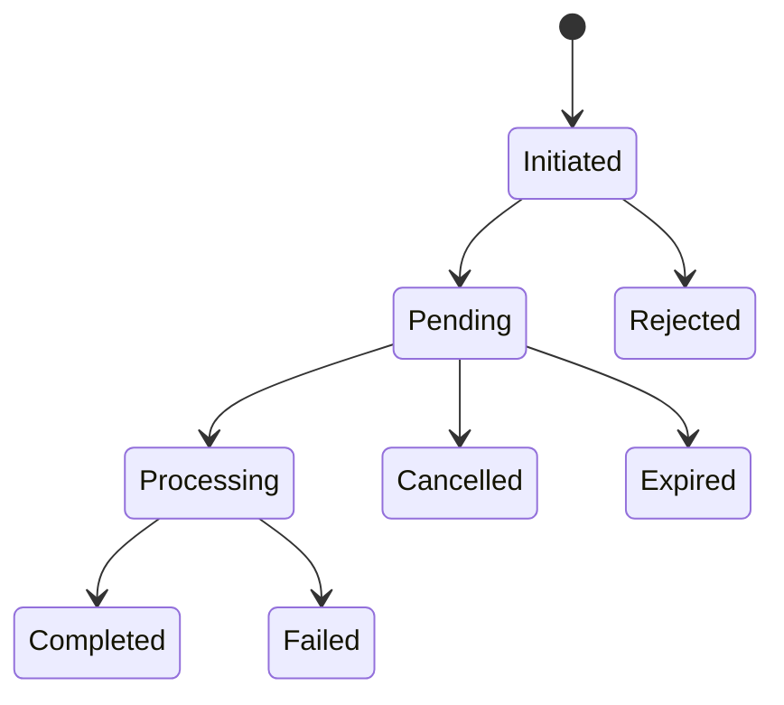
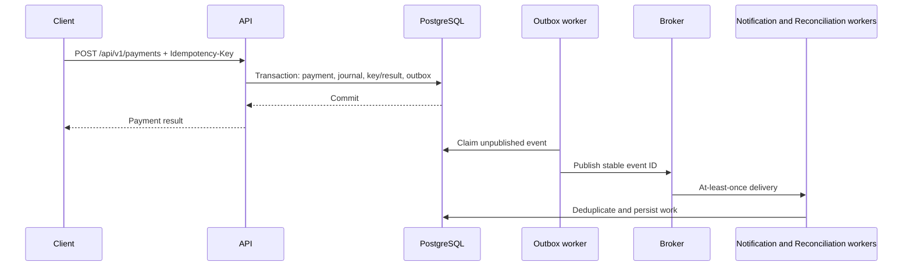
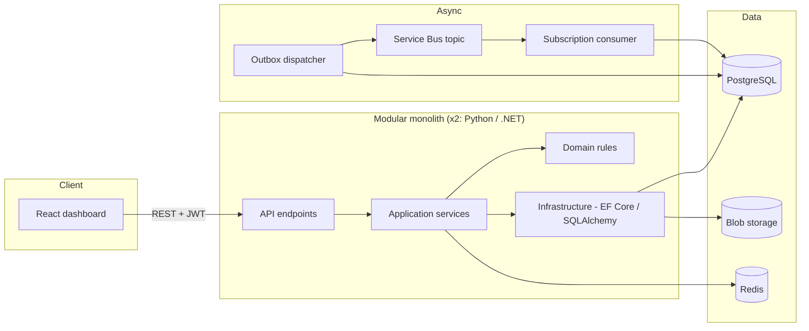
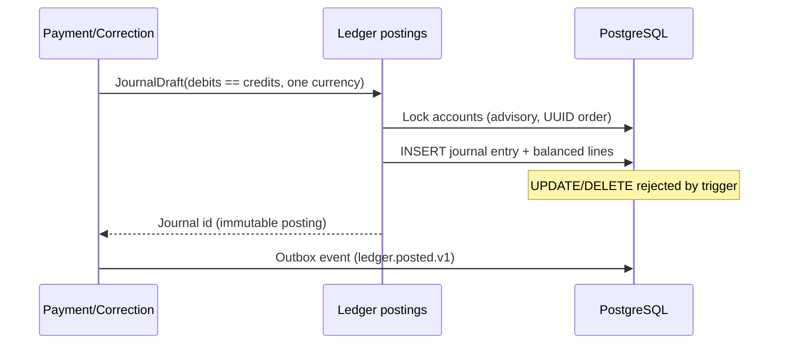
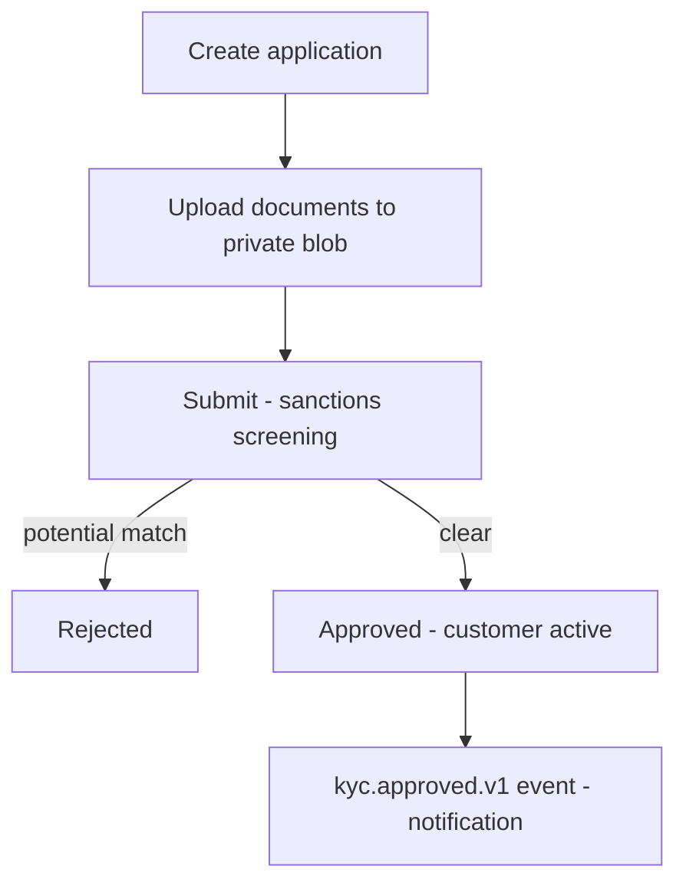
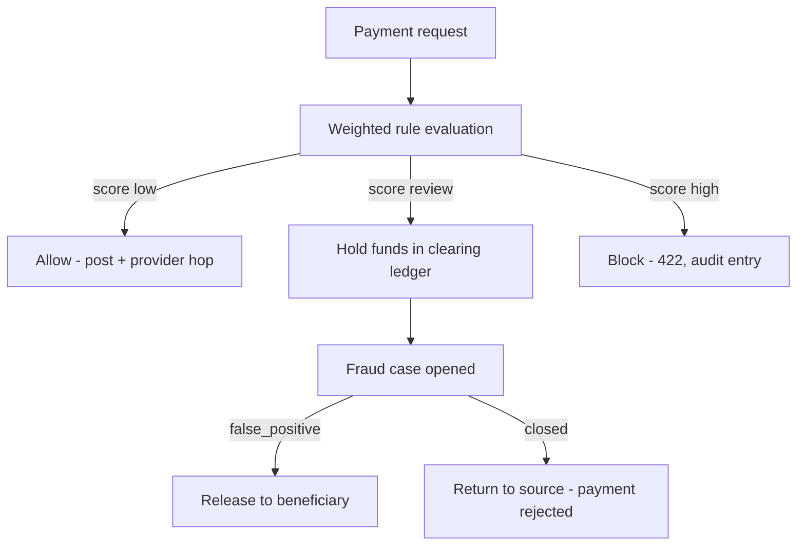
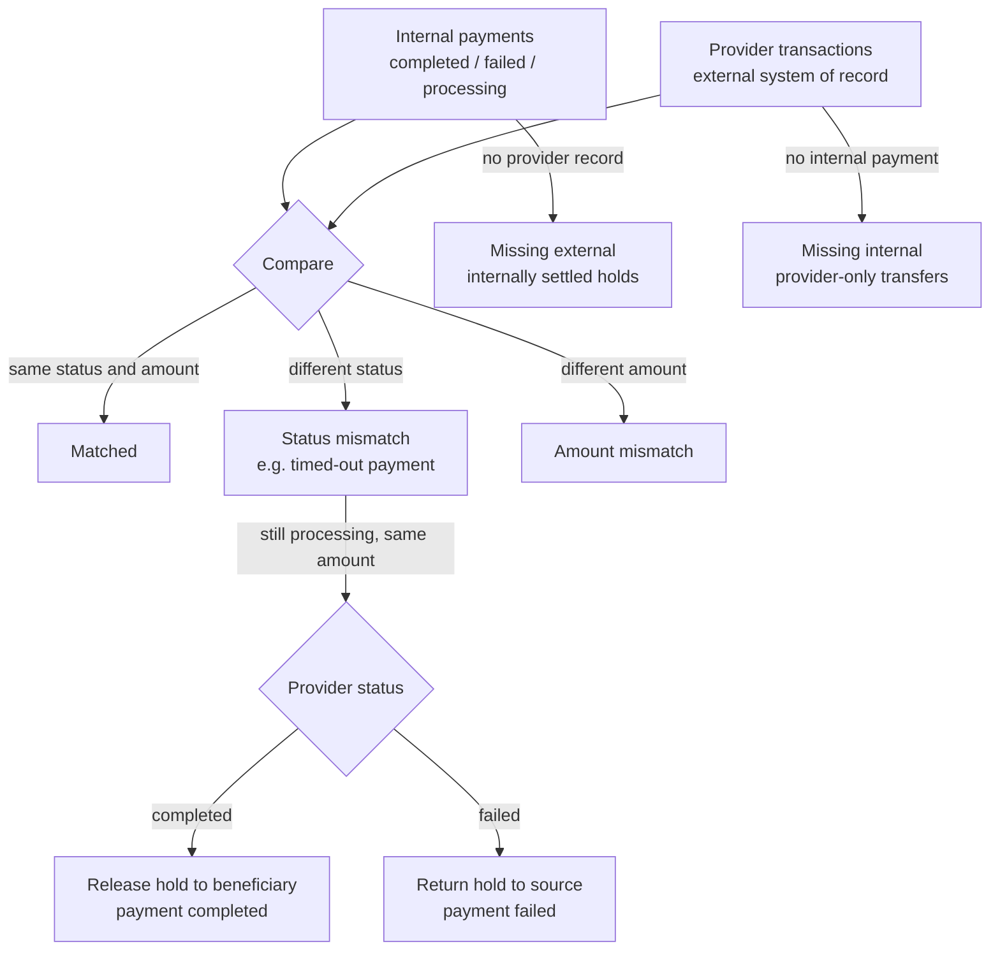
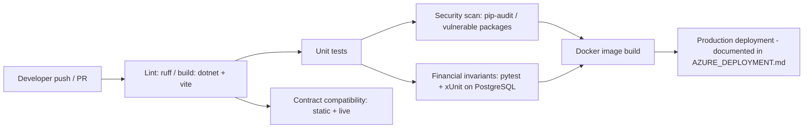
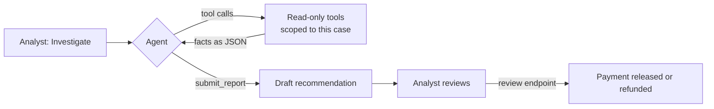
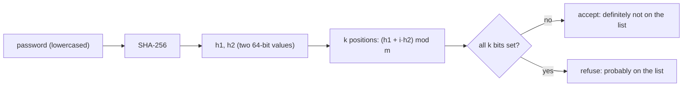

# FinCore Architecture

## Goals and boundaries

FinCore demonstrates payment-system concepts while remaining suitable for local development. Two independent backends implement one externally visible contract. The frontend contains no authoritative financial rules. PostgreSQL is the source of truth for transactional and workflow state.

Start with one modular monolith per language. Modules communicate through application interfaces and domain events, not internal HTTP. This preserves business boundaries without imposing microservice operational overhead before scale or team ownership requires it.

## Layers

```text
HTTP/API -> Application use cases -> Domain model and rules -> Infrastructure adapters
```

* **API:** authentication, authorization, validation, HTTP mapping, rate limiting, and OpenAPI.
* **Application:** use-case coordination, transaction boundaries, ports, and orchestration.
* **Domain:** entities, value objects, state machines, and invariants without framework/database dependencies.
* **Infrastructure:** PostgreSQL repositories, Redis, broker, blob storage, token validation, and telemetry.
* **Workers:** consume durable messages and perform retryable notification/reconciliation work.

## Business modules

| Module | Owns | Key invariant |
|---|---|---|
| Identity & Customer | credentials, profile, lifecycle | customers cannot access another customer's resources |
| KYC | applications and document metadata | document bytes stay in private object storage |
| Accounts | accounts, limits, holds, balance views | concurrent requests cannot spend funds twice |
| Beneficiaries | destination enrollment and cooling period | ineligible beneficiaries cannot receive transfers |
| Payments | lifecycle and request idempotency | same key and request returns original outcome |
| Ledger | ledger accounts, journals, lines | posted journals balance and are immutable |
| Fraud & Risk | configurable rules, score, reasons | decisions are recorded with explainable reasons |
| Reconciliation | internal/provider comparisons | mismatches remain visible until resolved |
| Notifications | delivery intent and attempts | delivery failure cannot undo a posted transfer |
| Audit & Reporting | append-only evidence and read models | sensitive actions are attributable and inspectable |

Each backend implements these capabilities internally. Logical module ownership is reflected in code and migrations; module dependencies go through application interfaces.

## Financial consistency

An internal transfer writes payment, fund reservation/posting, journal, idempotency result, audit fact, and outbox event in one PostgreSQL transaction. A journal balances per currency (`sum(debits) = sum(credits)`). Row locks or serializable isolation protect concurrent spends. Failed transactions leave no partial journal. Posted ledger history is never updated or deleted; corrections use a reversal and replacement entry.

Binary floating point cannot represent many decimal fractions exactly. Amounts use integer minor units and an ISO currency code; currency metadata defines the exponent. FX requires an explicit rate, rounding rule, and balanced postings.

Available balance is a view derived from posted ledger balance less active holds/reservations. A materialized or cached projection is disposable and rebuildable, never authority to spend. Database failure rejects writes instead of acknowledging success from cache.

## Payment state machine



Only explicit transitions are allowed; `Completed -> Processing` is invalid. Refunds and corrections are separate compensating operations.

## Payment and event flow



Idempotency keys are scoped to principal and operation and bound to a canonical request hash. Same key/same request returns the original result; same key/different request conflicts. A unique database constraint handles concurrent retries. Both backends serialize the payment request body into the same lexicographically ordered representation and hash it with SHA-256 so a key can be replayed through either backend. Outbox rows survive broker outages. Consumers deduplicate by event ID because delivery is at least once.

## System architecture



## Ledger flow



## KYC flow



## Fraud flow



## Reconciliation flow



A timed-out payment keeps its funds in the payment-holds ledger while its outcome is unknown. Each run records what it found first, then settles such payments from the provider's record, so the next run reports them as matched. Anything else that disagrees (an amount mismatch, or a payment already completed internally that the provider failed) is left for a person: moving money on contradictory evidence would be worse than leaving it visible.

## CI/CD flow



## Messaging

Production target: Azure Service Bus. Local development uses a compatible broker behind a messaging adapter. A **queue** distributes work to a consumer; a **topic** fans events out to named **subscriptions**. A **message** carries a versioned envelope and stable ID. Bounded exponential retries send poison messages to a dead-letter queue (DLQ) for inspection and controlled replay. Broker duplicate detection is defense in depth; consumers remain idempotent. Ordering is only guaranteed for explicitly selected account/session keys, never globally.

## Storage and runtime

PostgreSQL owns transactional state. Redis accelerates reads and supports rate limits but is not ledger evidence. Blob storage holds KYC bytes; PostgreSQL holds document metadata and object keys. Compose starts the React dashboard, both APIs, PostgreSQL, Redis, the Azure Service Bus emulator, and Azurite, so local messaging and storage use the same Azure SDKs and semantics (topics, subscriptions, duplicate detection, dead-lettering) as production. Outbox rows are published to Service Bus and consumed idempotently through an inbox table; see LOCAL_SETUP.md. `/health` is liveness; `/ready` reflects dependencies required to accept safe work.

## Scale and failure behavior

Stateless APIs scale horizontally. Start with indexes and measured query plans; add read replicas for safe read models, partition high-volume journal/audit tables, and scale workers by queue. Redis uses bounded TTL and rebuild paths. Sharding and service extraction follow measured bottlenecks and ownership requirements. Broker failure grows the outbox; worker failure retries then surfaces in DLQ; blob failure leaves document workflow retryable; Redis failure bypasses cache and applies conservative rate limits.

## Design decisions and known trade-offs

### Patterns in use

| Concern | Pattern | Where |
|---|---|---|
| Retried requests | Idempotency key claimed in the payment's own transaction; replays return the stored response | `payments.py`, `PaymentService.cs` |
| Reliable events | Transactional outbox, retry with backoff, dead letters with manual replay | `worker.py`, `OutboxDispatcherWorker.cs` |
| Duplicate delivery | Inbox table de-duplicates consumed messages | `messaging.py`, `Messaging.cs` |
| Concurrent spends | Pessimistic locking: per-account advisory locks in UUID order, `FOR UPDATE` on settled rows | `ledger_postings.py`, `LedgerPostings.cs` |
| Payment lifecycle | Explicit state machine; every transition is checked | `payment_state.py`, `PaymentStatus.cs` |
| Ledger integrity | Immutable double-entry journals; corrections post mirror entries | `ledger_postings.py`, `LedgerPostings.cs` |
| Unknown outcomes | Funds held while a provider outcome is unknown; reconciliation settles them | `payment_holds.py`, `PaymentHoldService.cs` |
| Read load | Cache-aside for limits and fraud rules, invalidated on change | `cache.py`, `FinCoreCache.cs` |
| Abuse | Fixed-window rate limits per IP or customer, plus login attempts per account, shared through Redis | `ratelimit.py`, `RateLimitMiddleware.cs` |
| Resource exhaustion | Request bodies capped at `MAX_REQUEST_BODY_BYTES` (8 MiB) | `main.py`, `Program.cs` |
| Weak passwords | Bloom filter of common passwords, checked at registration | `bloom.py`, `BloomFilter.cs` |
| AI assistance | Tool-using agent with read-only, case-scoped tools; a person decides | `fraud_investigator.py`, `FraudInvestigator.cs` |
| Tracing | Correlation IDs on every response, W3C trace context carried through the outbox | `main.py`, `CorrelationIdMiddleware.cs` |

Optimistic concurrency (row versions) is not used: every contended write already runs under a pessimistic lock, which suits short, high-value transactions where a lost update must never happen and a retry storm is worse than a short wait.

A circuit breaker is not used either. The provider is an in-process simulator with no network hop, so there is nothing to trip on. A real provider integration should add one, together with timeouts, around the outbound HTTP call.

### Fraud investigator agent

Fraud analysts can ask an AI agent to investigate a flagged payment (`POST /api/v1/fraud/cases/{caseId}/investigate`). It gathers evidence with tools, then drafts a recommendation: release the payment, confirm fraud, or escalate. **It never decides.** The analyst reads the draft and makes the decision with the existing review endpoint, which is where money moves.

Both backends implement it with the framework native to their language, on Google Gemini:

| | Python | .NET |
|---|---|---|
| Framework | LangGraph state graph over a LangChain chat model | Microsoft Agent Framework `ChatClientAgent` |
| Model client | `langchain-google-genai` (`ChatGoogleGenerativeAI`) | OpenAI .NET client on Gemini's OpenAI-compatible endpoint, through `Microsoft.Extensions.AI` |
| Loop | `agent` and `tools` nodes with conditional edges; ends when a report is submitted or the turn budget is spent | `FunctionInvokingChatClient` with `MaximumIterationsPerRequest`; `submit_report` sets `Terminate` |
| Code | `app/agents/fraud_investigator.py`, `app/services/investigation_facts.py` | `FraudInvestigator.cs`, `InvestigationFacts.cs` |



The two agents share their instructions word for word (`resources/fraud_investigator_prompt.txt` in each backend, kept identical by `tests/test_contract.py`), the same tool names and descriptions, the same fact shapes (same JSON keys, money formatting and day arithmetic), and the same report schema, so an analyst gets the same kind of answer whichever backend serves them.

**Safeguards:**

* **Read-only, case-scoped tools.** No tool takes an identifier: each is a closure over the one case being investigated, so a manipulated model cannot read another customer's data or change anything.
* **Aggregates, not rows.** Tools return counts, typical amounts and ages, and no names, emails or KYC documents, which limits what reaches the model provider.
* **Untrusted text is labelled.** Payment references and beneficiary labels are typed by customers and may contain instructions. Tools return them under `customerSuppliedText`, and the instructions tell the model to treat that field strictly as data. Even if an injection worked, the agent has no tool that changes anything.
* **Validated output.** The report is a tool call with a schema (recommendation, confidence, summary, findings, a note of at most 200 characters). An invalid report goes back to the model to fix rather than reaching the analyst.
* **Bounded cost and time.** `AGENT_MAX_STEPS` model turns (8), `AGENT_TIMEOUT_SECONDS` (90), and its own rate-limit bucket, `RATE_LIMIT_AGENT_PER_MINUTE` (5 per user), because each investigation makes several paid model calls.
* **Accountable.** Every investigation is audited as `fraud.case.investigated`, with the recommendation, the tools used, the model and the number of turns.
* **Off by default.** Without `GEMINI_API_KEY` the endpoint answers `503 agent_not_configured`, `GET /api/v1/fraud/agent/status` reports it disabled, and the UI hides the Investigate button.

Investigations are not stored: each run is computed fresh, and only the audit entry remains. Tests replace the model with a scripted one, so they run offline and cost nothing; on .NET the scripted client runs inside the real Agent Framework and function-invocation loop.

### Bloom filter for common passwords

Registration refuses passwords found on a common-password list (`password_too_common`, 422). The list is held in a Bloom filter rather than a set: a fixed-size bit array plus `k` hash functions. Adding a password sets its `k` bits; a lookup checks them. If any bit is clear, the password is definitely not on the list; if all are set, it probably is.



* **Why a Bloom filter.** Size depends only on the item count and the false-positive rate, never on the items themselves. At 0.1% it takes about 14.4 bits per password, so a million-entry breach list fits in about 1.8 MB of memory. The plain list would take tens of megabytes as a set.
* **Why errors are safe here.** There are no false negatives, so a listed password is always refused. A false positive (0.1%) refuses a password that is not on the list, which only means the user picks another one. That makes this a good use of a Bloom filter; a check where a false positive would block a legitimate payment would not be.
* **Sizing.** `m = -n ln(p) / (ln 2)^2` bits and `k = (m / n) ln 2` hashes, both computed from the list at startup.
* **Two languages, identical bits.** Both backends derive positions by double hashing over SHA-256, reducing each term modulo `m` so the arithmetic fits in 64 bits. A shared test vector (`test_bloom.py`, `BloomFilterTests.cs`) proves both set the same bits, and `tests/test_contract.py` keeps the two bundled lists byte-for-byte identical.
* **The list.** The bundled `common_passwords.txt` holds common patterns of 12 characters or more; shorter passwords are already refused by the length rule. For real protection, set `COMMON_PASSWORDS_PATH` to a breached-password corpus with one password per line. The filter is built once at startup, and the list itself is not kept in memory.
* **Limits.** A Bloom filter cannot remove entries; rebuild it (restart) when the list changes. Lookups compare lowercased passwords, so `Password1234` is refused along with `password1234`.

### The provider call runs inside the payment transaction

The simulator records its `ProviderTransaction` row in the same database transaction as the payment. That keeps the demo deterministic, but it is not how a real integration can work: if our transaction rolls back after a real provider accepted the transfer, the provider still moved the money, while here its record disappears with ours.

A production integration splits the payment in two:

1. Commit the payment as `processing` with its funds held, plus an outbox request to call the provider.
2. A worker calls the provider outside any database transaction, with the payment id as the provider's idempotency key, and commits the outcome in a second transaction: release the hold to the beneficiary, or return it.

A crash between the two steps leaves a held `processing` payment, which reconciliation already resolves from the provider's record. That recovery path is the one timed-out payments use today.

### Balances are recomputed from the journal

The balance check sums every journal line of the source account, under the account lock, on each payment. That is always correct and needs no extra state, but its cost grows with the account's history. Once accounts carry many thousands of lines, add a balance snapshot: a per-ledger-account row holding the balance up to a known journal position, updated in the same transaction as each posting. The check then reads the snapshot and only the lines after it. The journal stays the authority, and a snapshot can always be rebuilt from it.

### Reports never sum across currencies

Report series carry one row per period per currency, and each currency with activity in the window gets its own zero-filled series. Totals that mix currencies would need an explicit FX rate and rounding rule (see Financial consistency), so the dashboard shows one currency at a time.

## Current implementation status

Both backends implement the full module set against one shared contract: auth with refresh-token rotation, accounts and beneficiaries with cooling periods, the ledger with immutable journals and advisory-lock concurrency, payments with the provider-simulator hop and the complete payment state machine, refunds/reversals, the chargeback dispute workflow, settlement batches with generated payout files, KYC with private document storage and sanctions screening, the configurable fraud rules engine with case review and held-payment settlement, AML monitoring with alert review, reconciliation against the provider's own transaction records (including missing-external/missing-internal findings), notifications across four channels, the outbox with retry, dead-letter handling and manual replay, reports with CSV export, admin user management, rate limiting, and audit logging that is append-only at the database level. The React app covers every workflow including treasury, disputes and settlements. The pytest and xUnit suites cover both backends, and CI runs linting, unit tests, security scans, financial invariants against a real PostgreSQL, and cross-backend contract tests. Transfers do not settle externally; the provider is a deterministic simulator and local data is demo data.

## Security and operations

Use short-lived signed tokens, policy authorization, strict DTO allowlists, TLS in deployed environments, managed secrets, rate limits, safe structured logs, trace IDs, metrics, and traces. Never log tokens or KYC contents. Audit records identify actor, action, resource, time, correlation ID, and outcome under least privilege and retention controls. Local emulators do not provide production compliance or disaster recovery. See [security](SECURITY.md), [Azure target](AZURE_DEPLOYMENT.md), and [incident runbooks](TROUBLESHOOTING.md).
