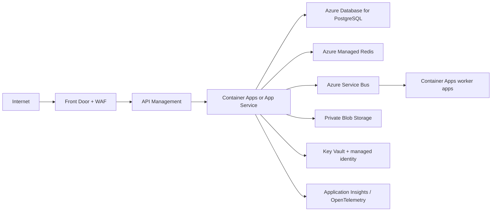

# Azure Production Evolution

Container Apps is a lower-operations option for APIs/workers; App Service is managed web hosting; AKS adds orchestration control and operational cost and is not needed initially. PostgreSQL provides managed relational storage; Service Bus provides durable queues/topics and DLQs; Blob Storage holds private documents. Use private networking, least privilege, encryption, monitored backups, and tested restore/failover.

A paired-region plan states RPO/RTO and validates database replication and queue/blob recovery. This is a target, not deployed infrastructure.
