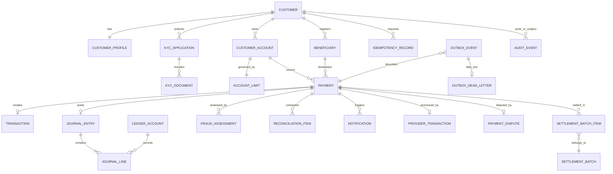

# Database Design

PostgreSQL is authoritative. Amounts are integer minor units plus currency, never floating point. Store timestamps in UTC and use opaque UUIDs. Foreign keys, uniqueness, and check constraints backstop domain validation.

## Initial entities and invariants

* `Customer`, `CustomerProfile`: lifecycle/profile; normalized login is unique. Credentials use a protected identity representation.
* `KycApplication`, `KycDocument`: workflow state and object key only; private blob storage holds document bytes.
* `CustomerAccount`: owner, type, currency, status. Currency cannot silently change.
* `AccountLimit`: configurable per-transfer/daily/weekly/monthly limits and effective interval.
* `Beneficiary`: owner, destination reference, verification state, and cooling timestamps.
* `Payment`: source, destination, minor-unit amount, currency, state, risk result, timestamps, provider reference/status.
* `Transaction`: immutable business posting reference.
* `LedgerAccount`: chart-of-account identity, currency, owner/reference, status.
* `JournalEntry`, `JournalLine`: immutable posting and positive debit/credit amounts. Each posted journal balances per currency; posted lines cannot change or be deleted (database triggers).
* `IdempotencyRecord`: principal, operation, key, request hash, response/status, timestamps; unique `(principal, operation, key)`.
* `OutboxEvent`: ID, type/version, aggregate key, payload, publish state, attempts/error, trace context. Consumers maintain deduplication/inbox records.
* `OutboxDeadLetter`: exhausted-retry events with failure reason and a replay timestamp for manual replay.
* `ProviderTransaction`: the external provider simulator's own record of each processed payment; unique per payment and per reference. The payment id has no foreign key on purpose — the provider may hold records the platform does not (reconciliation's "missing internal").
* `PaymentDispute`: the chargeback workflow — one per payment, `open → under_review → won/lost`, with JSONB evidence entries.
* `SettlementBatch`, `SettlementBatchItem`: daily payout batches (pending/processing/completed/failed) with gross, fee, net, and generated file content; a payment belongs to at most one batch.
* `FraudRule`, `FraudCase`, `AmlAlert`, `ReconciliationRun`/`ReconciliationRecord`, `Notification`, `AuditLog`, `RefreshToken`: durable evidence for decisions, mismatches, delivery, tokens, and actor actions. Audit rows are append-only (database trigger, migration 0007).

Available balance equals posted balance less active holds/reservations. A persisted projection is rebuildable and reconciled against journals. Payment implementation uses row locking plus advisory account locks (stable UUID order) to prevent concurrent overspend. Business validation failures roll back the idempotency claim so clients can correct and retry; successful requests replay the stored result. The payment flow commits the payment, balanced journal lines, the provider transaction, the idempotency record, lifecycle events, and audit entries in one transaction.

## Index and retention plan

Index customer login, account owner/status, payment account/state/time, journal account/time, idempotency uniqueness, unpublished outbox rows, and audit subject/time. Defer partitioning until load measurements justify it. Retention/deletion policy must account for financial evidence, privacy, and legal obligations; this educational design is not compliance certification.
